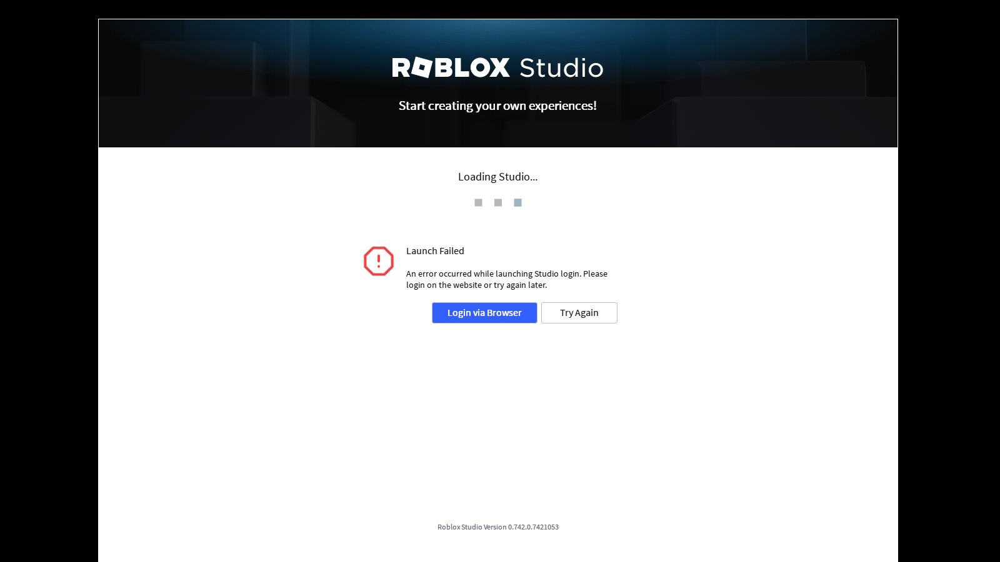

# Roblox Studio Mobile

A personal Android build that runs the **Windows version of Roblox Studio** on an ARM64 phone,
using **Wine** (Windows API layer) and **Box64** (x86-64 → ARM64 translator). It is a small patch
on top of [Winlator](https://github.com/brunodev85/winlator) (LGPL-2.1), which already packages
Wine, Box64, DXVK and the Turnip/Vortek Vulkan drivers into an Android app.

> **Roblox Studio is not included** in this repository or in the APK. The app downloads it from
> Roblox's official deployment servers (`setup.rbxcdn.com`) the first time it starts, exactly like
> Roblox's own installer does, and keeps it updated on later launches.

## Download & install

- APK: [`apk/RobloxStudioMobile.apk`](apk/RobloxStudioMobile.apk) (≈156 MB, stored with Git LFS —
  use GitHub's "Download raw file" button). Version `11.2-studio8`, arm64-v8a only.
- SHA-256: `4f0c45192d176bbf141b17deb78687728df68155e2914397926efc0e0cfa72cc`
- Signing certificate SHA-256: `f7e1905ea92f6341e4d585f5514f7d0a17e36a2c18e5425e5f5cb0617e4c1e69`
  (personal key; the keystore and its password are not in this repo).

1. Uninstall the official Winlator app if you have it (same package name, different signature).
2. Open the APK on the phone and allow "Install unknown apps" for your browser/file manager.
3. Open **Roblox Studio Mobile**, allow storage access, and keep it on Wi-Fi for the first start
   (about 575 MB is downloaded from Roblox).

## What happens when you open the app

1. Installs the Windows environment (Wine + Box64 rootfs bundled with Winlator) — first launch only.
2. Creates a Wine container called "Roblox Studio" (DXVK for Direct3D 11, Turnip on Adreno GPUs
   or Vortek elsewhere, Box64 "Conservative" preset because Studio is heavily multi-threaded).
3. Asks Roblox for the current Studio version, downloads ~575 MB of packages (MD5-verified, ~1.1 GB unpacked)
   and unpacks them into `C:\Program Files\Roblox Studio` using the package → folder map read out of
   the official `RobloxStudioInstaller.exe` (same technique as Vinegar/Bloxstrap).
4. Starts `RobloxStudioBeta.exe` full screen.

After Studio is closed the app shows a launcher screen instead of relaunching it. "Winlator settings
(advanced)" opens the normal Winlator UI for tuning graphics drivers, Box64 presets, etc.

### Logging in

Studio's built-in login window needs Microsoft WebView2, which is not installed (it is very heavy
under Box64), so Studio shows **"Launch Failed … Login via Browser"**. Tap **Login via Browser**:
the login page opens in your Android browser, and when roblox.com redirects to the
`roblox-studio-auth:` link, Android hands it to this app, which passes it to the running Studio —
the same way it works on Windows. The callback is too long for one WinHandler request (256 bytes),
so the app writes the command into `C:\windows\temp\roblox-studio-auth.bat` and runs it with
`cmd.exe /c`. `colab/stage5_auth.py` checks this with Wine's real `cmd.exe`: the argument arrives
byte-for-byte, and a running Studio logs "Successfully received external login code".

## If something crashes

The launcher has a **Save crash report** button. It writes `Download/RobloxStudioMobile-report.txt`
with: Android's record of why the app last died (including native-crash backtraces on Android 12+),
any Java crash trace, the Wine/Box64 output of the last two Studio sessions, Roblox Studio's own log
files, and device/GPU/container info. If the previous session crashed, the launcher says so instead
of relaunching straight away.

## Requirements / expectations

- 64-bit ARM Android 8+ phone; 6 GB+ RAM and ~3 GB free storage recommended.
- Snapdragon (Adreno) GPUs work best (Turnip Vulkan driver). Others use Vortek and may be slower.
- Studio is a big desktop app: expect slow start-up and modest frame rates.
- The package name must stay `com.winlator` (Winlator's rootfs has that path compiled in), so
  **uninstall the official Winlator first** — the two can't be installed side by side.

## Building

See also [HANDOFF.md](HANDOFF.md) for continuing work in a new session.

```
ANDROID_HOME=/path/to/sdk ./build.sh
```

`build.sh` fetches `brunodev85/winlator-app` at the pinned commit, applies `patches/`, and runs the
Gradle release build. Put a `keystore.properties` next to the script to get a signed APK (see the
comment at the top of `build.sh`). Keystores and passwords are git-ignored and never committed.

## Colab test

`colab/stage1_setup.py` and `colab/stage2_run.py` install Wine on a Google Colab VM, download Studio
with the same CDN logic as the app, and launch it on a virtual X display. Result with Wine 11.0
(software rendering), Studio 0.742:



That test covers the Studio-under-Wine part, not the APK itself.

`colab/stage3_emulator.py` + `stage3b_install.py` tried the APK in an Android 11 x86_64 emulator on
an 8-vCPU Colab VM. Colab has no KVM, so the emulator runs on pure software CPU emulation: Android
booted (7.6 min) and the APK installed, but every time the app was opened Android killed it after
its fixed 10-second start limit ("failed to attach … start timeout"), because the arm64-only app
must also go through Android's ARM→x86 translator. So the APK could not be shown running in an
emulator; it needs a real ARM64 phone.

## Changes to Winlator (`patches/0001-roblox-studio-launcher.patch`)

- `studio/StudioLauncherActivity` — new launcher screen and first-run/update flow.
- `studio/StudioInstaller` — Roblox CDN download, MD5 check, safe unzip, staged install.
- `XServerDisplayActivity` — `exec_args` extra, "session running" flag, and `onNewIntent` that runs
  a program in the live session (used for the browser-login callback).
- `XInputExtension` (Winlator's X server) — implements XInput 1 `ListInputDevices` (replies "no devices").
  It used to answer BadImplementation, which makes Xlib terminate the Wine process that asked; Studio's
  Qt tablet probe triggered it and took down Wine's desktop process, ending the session.
- `Drawable` / MIT-SHM / DRI3 (Winlator's X server) — fixes the SIGSEGV (SEGV_ACCERR) in
  `Drawable.copyArea` seen on a Galaxy S25 Ultra: a window could keep pointing at a client's
  **read-only** shared-memory image, and the next draw into it wrote to read-only memory. Drawables
  now switch to a writable copy before any write (copy-on-write), are moved off a segment before
  it is unmapped, SHM mappings are reference-counted, `drawImage` clips to both buffers, the GPU
  buffer stride is only used while pixels are in that buffer, and a failed `AHardwareBuffer_lock`
  no longer yields a garbage pointer. Core CopyArea (and PresentPixmap) now clip to the *source*
  drawable too: copying a rectangle larger than the source read past its buffer (second S25 Ultra
  crash, right after login); 1-bit images and cursor masks are bounded as well. `tests/drawable/run.sh` reproduces the crash scenario on the
  host with Winlator's real native code and checks the fix.
- `DrawRequests.copyArea` / `GLRenderer` — a CopyArea from an offscreen GPU window (a Direct3D/
  Vulkan child window) into part of a window is drawn as a positioned overlay. Winlator used to
  replace the whole window's texture with the child's, which stretched Studio's 29-pixel top bar
  over the entire window and made it flicker with the start page.
- `AppUtils.restartApplication` — ends the process with `killProcess` instead of `Runtime.exit`, which
  could SIGSEGV while the X server/audio/renderer threads were still running.
- `RootFSInstaller` — completion callback; `AndroidManifest` — new launcher + `roblox-studio-auth`
  link handler; release signing config read from `keystore.properties`.

## License

The patch is a modification of Winlator and is distributed under the same LGPL-2.1 license.
Wine (LGPL), Box64 (MIT), DXVK (zlib) and Mesa (MIT) keep their own licenses. Roblox and Roblox
Studio are trademarks of Roblox Corporation; this project is not affiliated with Roblox.
